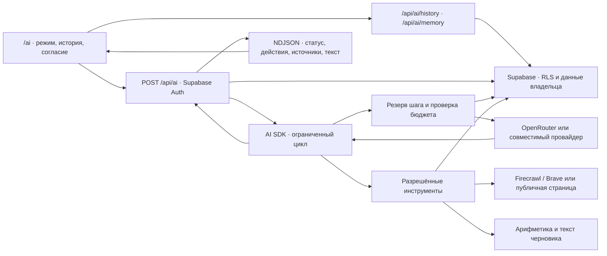

# NEXUS AI

## Архитектура

Сервер проверяет сессию, согласие, источник обращения и входные поля. Вопрос получает идентификаторы диалога, сообщения и попытки. Повтор той же попытки запрашивает её результат. Новая попытка может заменить последний ответ. Ошибка регенерации сохраняет предыдущий ответ. Запущенные попытки ограничены по времени. Прерванный запуск можно повторить после освобождения блокировки или истечения её срока. Удаление диалога удаляет его сообщения и резюме.

Агент сам выбирает доступные инструменты. Каждый модельный запрос резервирует одну попытку в Supabase. Это относится также к сжатию истории и резервному вызову провайдера. К модели попадают текущий вопрос, ограниченный фрагмент переписки, её резюме при наличии и добровольно сохранённые пожелания. Выключение и сохранение настроек памяти очищает текст пожеланий. История остаётся под отдельным управлением.

Интерфейс показывает фрагменты ответа, действия и полученные источники. Текст действия описывает вызов инструмента. Указания с внешних страниц, из публикаций и сохранённого контекста обрабатываются как данные. В ответе кликабельны ссылки из зарегистрированных источников. Результат поиска — выдержка из выдачи. Чтение статьи и сопоставление утверждений выполняются отдельными шагами.

| Режим | Максимум в цикле до ограничений окружения и остатка дневной квоты | Поведение |
| --- | ---: | --- |
| Быстрый ответ | 1 шаг, 0 инструментов | Короткий ответ без отдельного сжатия истории. Настроенный резерв может расходовать дополнительное обращение. |
| Авто | 4 обращения, 5 инструментов | Агент выбирает действия по вопросу. |
| Исследование | 6 обращений, 8 инструментов | Начинает с нескольких запросов при настроенном поиске, затем сравнивает источники. |
| Решение задачи | 4 обращения, 5 инструментов | Проверяет расчёты и объясняет решение. |

## Модели и инструменты

В живой проверке использован маршрутизатор `openrouter/free`. Он выбирает доступную бесплатную модель, поэтому конкретная модель может меняться. Настраиваемые основной и резервный идентификаторы проверяются по каталогу OpenRouter. Для режимов с инструментами каталожная запись должна заявлять их поддержку. Бесплатная конфигурация требует нулевой цены, запрещает платную маршрутизацию и отключает резервирование на стороне OpenRouter. Внутренний резерв используется при совместимой ошибке до начала потока и учитывается в лимитах. OpenAI, DeepSeek, Gemini и другой HTTPS API с совместимым интерфейсом настраиваются отдельно. Ollama предусмотрен для loopback в локальной разработке. Живая совместимость этих дополнительных вариантов пока не подтверждена. [Документация OpenRouter о вызове инструментов](https://openrouter.ai/docs/guides/features/tool-calling).

| Инструмент | Что он получает или делает |
| --- | --- |
| `calculate` | Арифметика с ограниченным синтаксисом и глубиной. Вычисления используют числа с плавающей точкой. |
| `searchWeb`, `researchTopic` | Выдача Firecrawl или Brave, включая даты и ссылки, если они доступны. Для нескольких поисковых запросов действует единый бюджет вопроса. |
| `readWebPage` | Читает HTML или текст по публичному адресу из вопроса или выдачи. Проверяет переходы и IP, привязывает соединение к проверенному адресу, ограничивает размер и время загрузки. |
| `getMyProfile`, `getMyCommunities` | Учебные поля собственного профиля и список сообществ пользователя. Требуют отдельного разрешения в чате, серверной проверки сессии и RLS. |
| `searchNexusContent`, `searchLearningMaterials`, `summarizeAuthorizedContent` | Поиск и чтение материалов из общей ленты при разрешённом контексте. Закрытые группы, переписки, вложения и отдельный каталог учебных материалов в область поиска не входят. |
| `createDraftPost` | Готовит текст для редактирования в ответе. Публикация остаётся ручным действием в NEXUS. |

Для вопросов о личных данных NEXUS и веб-исследования лучше использовать разные запросы. Сервер запрещает передавать результат внутреннего инструмента в последующие внешние веб-вызовы в пределах той же попытки. Пользовательское согласие охватывает передачу контекста самому модельному провайдеру.

## Окружение

Скопируйте [.env.example](../../.env.example) в `.env.local` при первой настройке. В существующей локальной копии заполните только недостающие поля. Используйте URL и publishable key целевого Supabase. Ключи модели и поиска задаются только на сервере. `.env.local` хранится локально и исключён из Git. Браузер получает название провайдера и состояние доступности функций.

| Переменная | Назначение и значение по умолчанию |
| --- | --- |
| `NEXT_PUBLIC_SUPABASE_URL`, `NEXT_PUBLIC_SUPABASE_PUBLISHABLE_KEY`, `NEXT_PUBLIC_SITE_URL` | Supabase и адрес приложения. Для локального запуска используйте `http://localhost:3000`. Для Preview укажите адрес тестовой базы и Preview. |
| `AI_ENABLED` | Для работы агента задайте `true`; по умолчанию выключен. |
| `AI_PROVIDER`, `AI_API_BASE_URL`, `OLLAMA_BASE_URL` | Провайдер по умолчанию — `openrouter`. Остальные встроенные значения — `openai`, `deepseek`, `gemini`, локальный `ollama`. Для своего совместимого API укажите явный HTTPS base URL. У Ollama по умолчанию `http://127.0.0.1:11434`; на Vercel он отключён. |
| `OPENROUTER_API_KEY`, `AI_API_KEY` | Серверные ключи. Для OpenRouter можно использовать существующий `OPENROUTER_API_KEY`. Если заданы оба, используется `AI_API_KEY`. |
| `AI_MODEL`, `AI_FALLBACK_MODEL` | Идентификаторы моделей. Для OpenRouter оба по умолчанию `openrouter/free`, одинаковые значения не добавляют резервную попытку. |
| `AI_DAILY_USER_LIMIT`, `AI_DAILY_GLOBAL_LIMIT` | По умолчанию 5 вызовов модели на пользователя и 40 на проект за UTC-сутки. Серверные переменные могут понизить лимиты. Повышение требует настройки `ai_quota_settings` в целевой базе. |
| `AI_MAX_TOOL_STEPS`, `AI_MAX_TOOL_CALLS` | Общие ограничения цикла — 6 шагов модели и 8 вызовов инструментов по умолчанию. Режим и остаток дневной квоты могут ограничить их дополнительно. |
| `AI_REQUEST_TIMEOUT`, `AI_MAX_INPUT_BYTES`, `AI_MAX_OUTPUT_TOKENS` | По умолчанию 65 000 мс, 28 000 байт тела модельного запроса, до 1600 токенов на ответ модели. У коротких режимов меньше. |
| `AI_REASONING_SUPPORTED`, `AI_REASONING_EFFORT` | Необязательная отправка параметра рассуждения модели. Включайте для совместимой модели с `true` и одним из `low`, `medium`, `high`. Внутренние рассуждения в чат не пересылаются. |
| `AI_DISABLED_TOOLS` | Список точных имён отключаемых инструментов через запятую. |
| `WEB_SEARCH_PROVIDER`, `WEB_SEARCH_API_KEY` | Для поиска задайте `firecrawl` или `brave` и действующий ключ соответствующего сервиса. При отсутствии ключа интерфейс сообщает, что поиск отключён. |
| `WEB_SEARCH_COST_PER_REQUEST`, `AI_MAX_SEARCH_CALLS`, `AI_MAX_SEARCH_COST` | По умолчанию расчётные $0,005 за запрос, до 3 запросов и до $0,015 на один запуск. |
| `AI_ALLOW_PAID`, `AI_MAX_REQUEST_COST`, `AI_INPUT_PRICE_PER_MILLION`, `AI_OUTPUT_PRICE_PER_MILLION` | Платный режим выключен. Для явного включения нужны допустимый бюджет в долларах и обе ставки на миллион токенов. Задайте ставки, покрывающие самую дорогую из выбранных моделей. |

Модель по умолчанию стоит $0 при доступности бесплатного маршрута. OpenRouter ограничивает ёмкость аккаунта и маршрута отдельно от NEXUS. При 5 обращениях на пользователя многошаговый ответ может исчерпать дневной остаток, особенно вместе с длинным диалогом или резервом. Для экономии начинайте с «Быстрого ответа» и используйте «Исследование» для задач, где нужны источники. [Лимиты OpenRouter](https://openrouter.ai/docs/api-reference/limits).

Базовый расчёт Brave соответствует опубликованной цене тарифа Search, $5 за 1 000 запросов по состоянию на 16.11.2026. Три запроса дают $0,015 до учёта кредитов. Проверьте свой тариф перед включением. Расчётные ограничения приложения дополняют настройки и счета провайдера. Vercel и Supabase учитывают выполнение функций, операции с данными и хранение отдельно. [Тариф Brave Search](https://brave.com/search/api/).

Firecrawl Free по состоянию на 17.11.2026 заявляет до 500 поисков в месяц без карты. Используйте отдельный бесплатный аккаунт или рабочее пространство без платного перерасхода. NEXUS отправляет поисковую строку, ограничивает выдачу пятью результатами и читает выбранный адрес собственным инструментом. Проверка с внешним API и локальным серверным ключом прошла. [Тариф Firecrawl](https://www.firecrawl.dev/pricing) · [API поиска Firecrawl](https://docs.firecrawl.dev/api-reference/endpoint/search).

## Локальный запуск

1. Используйте Node.js 24, как в CI. Из корня проекта выполните `npm ci`.
2. Для чистого тестового Supabase примените миграции проекта по порядку. В существующей тестовой базе проверьте наличие миграции `202610220001_ai_quotas.sql`, затем примените [202611130002_ai_agent.sql](../../supabase/migrations/202611130002_ai_agent.sql). Проверяйте целевую базу до запуска SQL.
3. Заполните `.env.local` по таблице выше, задайте `AI_ENABLED=true` и серверный ключ OpenRouter. Для поиска добавьте ключ выбранного поискового сервиса. Укажите в Auth локальные адреса входа по [инструкции NEXUS](../../README.md).
4. Выполните `npm run dev`, войдите тестовым аккаунтом и откройте [localhost:3000/ai](http://localhost:3000/ai). Подтвердите обработку запроса и выберите нужный режим.
5. Запустите `npm run typecheck`, `npm run lint`, `npm test` и `npm run build`.

Для изолированной проверки настоящей модели выполните `node --env-file=.env.local --experimental-strip-types scripts/check-ai-live.ts`. Скрипт проверяет числовой ответ и вызов инструмента без записи в Supabase. Аргументы `plan`, `python` и `page` запускают отдельные сценарии.

Аргумент `search` проверяет настоящий поисковый API независимо от доступности модели. После этого выполните интеграционный тест `tests/integration/ai-preview.test.ts` с `NEXUS_AI_PREVIEW_RUN=1`, `NEXUS_AI_PREVIEW_SEARCH=1`, `NEXUS_AI_PREVIEW_BASE_URL` и отдельным файлом переменных тестового Supabase. Он принимает только выделенный проект `nexus-storage-test`, проверяет вход двух временных пользователей, историю, квоты, память и источники, затем удаляет эти аккаунты.

## Выпуск на Vercel

1. Примените ожидающие миграции к изолированной базе Preview. Привяжите URL и publishable key только для соответствующей ветки Preview. Добавьте отдельные серверные ключи, `AI_ENABLED=true` и переменные выбранного поискового сервиса. Приложение использует Node.js runtime для чтения страниц с проверкой адресов. [Переменные окружения Vercel](https://vercel.com/docs/environment-variables).
2. Дождитесь статуса Ready, зелёной проверки `build` в PR и пройдите сценарии из таблицы ниже с двумя тестовыми аккаунтами. Проверьте потоковый ответ, повтор, остановку, сохранение после перезагрузки, удаление диалога, память, доступ с двух аккаунтов и видимость в узком окне. Для поиска подтвердите реальные источники и отсутствие сырых ошибок при отказе API.
3. Перед выпуском согласуйте конкретный PR и SQL с владельцем. Примените новую миграцию к production до развёртывания зависимого кода. Затем разверните проверенный коммит и проверьте `/ai` и вход в приложение. Для остановки генерации можно отключить `AI_ENABLED` и применить это новым развёртыванием. Сохраняйте таблицы истории, пока владелец отдельно не согласует удаление данных.

## Проверка и оставшиеся сценарии

Первый живой проход 13.11.2026 через `openrouter/free` вызвал калькулятор, получил 400 и объяснил вычисление. Результат занял 2 модельных запроса, 2 526 входных и 489 выходных токенов. Цена модели по бесплатной маршрутизации — $0. 16.11 прошли 163 автоматических теста. Проверки с подменой ответов подтвердили обработку потока, запасного маршрута, калькулятор, проверку адресов, ограничения и политики базы. Независимо от этого настоящий OpenRouter вызвал чтение страницы IANA и пересказал её со ссылкой.

В Chrome на 1440 и 390 px пройден путь через страницу `/ai`, маршруты Next.js и обе SQL-миграции в PGlite. Локальные HTTP-ответы Supabase Auth/REST и поток модели заменены тестовыми сервисами. Проверены согласие, появление текста до окончания потока, формулы, разрешённый источник из ленты, сохранение истории, запрет чтения чужого диалога, отказ по квоте, остановка с отменой сетевого запроса, повтор без второго вопроса, память и удаление диалога. Внешний Supabase и физический телефон этим проходом не проверены.

17.11 прошла production-сборка `npm run build -- --webpack`. Локальный Turbopack остановился на ограничении запуска процесса обработки CSS, которому требуется временный порт. Повторный сквозной запрос через Next.js и локальный SQL дошёл до OpenRouter, но общий маршрут вернул `provider_limit`, а проверенная альтернатива из бесплатного каталога — `provider_unavailable`. Эти прогоны подтвердили обработку ошибки у внешнего провайдера. Единый успешный сценарий через настоящий Supabase и модель остаётся для Preview.

| Сценарий приёмки | Доказательство и границы |
| --- | --- |
| План Python на месяц при 2 часах в день | Быстрый маршрут OpenRouter вернул контролируемое ограничение провайдера. |
| Новости за неделю | NEXUS получил источники из нескольких живых запросов Firecrawl с фильтром недели. Инструмент выбрало тестовое событие модели. Проверка вывода настоящей модели о новостях ещё нужна. |
| Исправление ошибки в Python | Настоящая модель обнаружила лишний индекс и предложила два корректных обхода списка. |
| Сравнение трёх IT-направлений | Цикл модели и инструментов проверен на расчёте. Для исследования востребованности нужны реальные поисковые источники. |
| Приватность | PGlite и Chrome с двумя тестовыми сессиями подтвердили закрытый доступ к чужой истории. Модель не получает инструментов переписки. Перед выпуском повторите проверку с реальным Supabase Auth. |
| Сбой модели и поиска | Целевые тесты проверили обработку ошибок, резервный вызов и отключённый поиск. |
| Одновременные запросы | Целевые тесты проверили состояния и атомарные ограничения SQL. Изолированные аккаунты и нагрузку проверяйте отдельно. |

Ключ поиска проверен локально. Для выпуска остаётся единый прогон с настоящей моделью, поиском и изолированным Supabase в целевом окружении. Сквозной прогон с OpenRouter 17.11 остановился на `provider_limit`. Качество ответа зависит от доступной модели. Сжатие истории может опустить детали. Фоновое возобновление, запуск пользовательского кода и чтение вложений в этот этап не входят.

После проверки поиска следующие работы — измерить качество ответов на коротких учебных сценариях, проверить расход на реальной нагрузке и добавить очередь для длительных исследований с восстановлением между запусками.

## Файлы

- Страница и интерфейс — [page.tsx](../../src/app/(community)/ai/page.tsx), [chat.tsx](../../src/features/ai/chat.tsx), [answer.tsx](../../src/features/ai/answer.tsx), [ai.module.css](../../src/features/ai/ai.module.css).
- Маршруты — [генерация](../../src/app/api/ai/route.ts), [история](../../src/app/api/ai/history/route.ts), [память](../../src/app/api/ai/memory/route.ts).
- Серверная часть — [engine.ts](../../src/features/ai/agent/engine.ts), [prompt-v1.ts](../../src/features/ai/agent/prompt-v1.ts), [context.ts](../../src/features/ai/agent/context.ts), [tools.ts](../../src/features/ai/agent/tools.ts), [web.ts](../../src/features/ai/agent/web.ts), [calculator.ts](../../src/features/ai/agent/calculator.ts), [http.ts](../../src/features/ai/agent/http.ts), [config.ts](../../src/features/ai/agent/config.ts), [contracts.ts](../../src/features/ai/agent/contracts.ts), [stream.ts](../../src/features/ai/agent/stream.ts).
- Хранение — [SQL-миграция](../../supabase/migrations/202611130002_ai_agent.sql), [типы схемы](../../src/types/database.ts), [типы AI](../../src/types/ai-database.ts).
- Проверки — [агент и инструменты](../../tests/ai-agent.test.ts), [изоляция и квоты](../../tests/ai-agent-database.test.ts), [живой вызов модели](../../scripts/check-ai-live.ts).
- Зависимости и сопровождение — [package.json](../../package.json), [package-lock.json](../../package-lock.json), [.env.example](../../.env.example), [PROJECT_STATE.md](../../PROJECT_STATE.md), [learnings.md](./learnings.md), [инструкция для сопровождения AI](./maintenance/SKILL.md).
